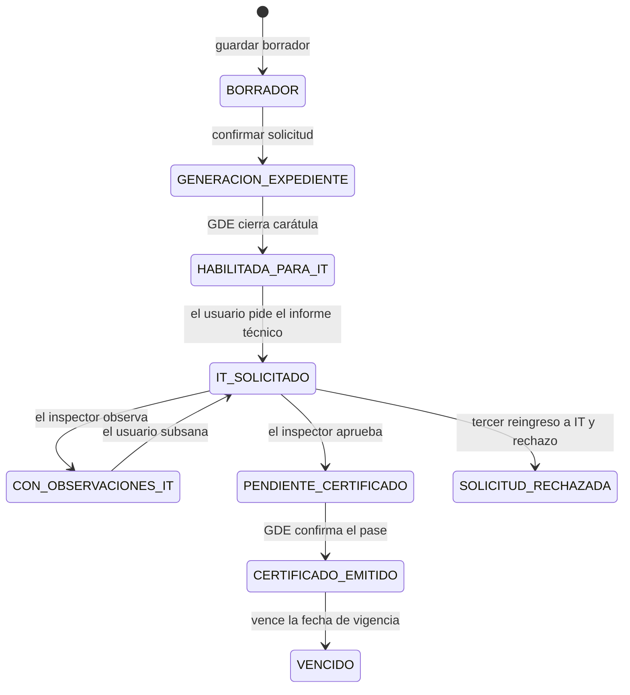
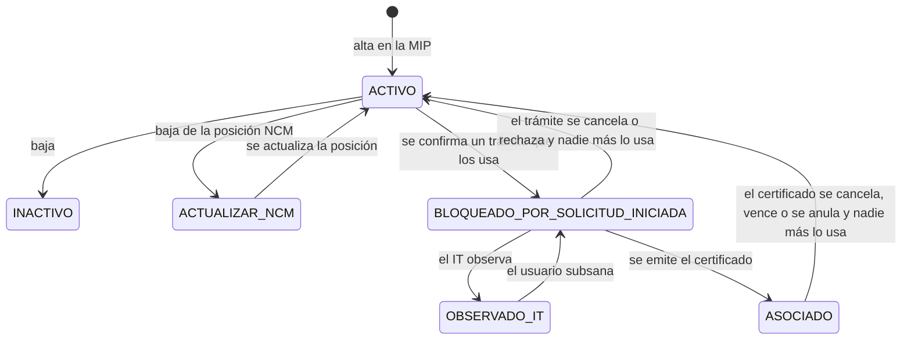

El ciclo de vida vive en `tramites-be`. Un trámite tiene un estado propio (`EstadoEnum`) y un tipo de solicitud (`nuevo`, `anula`, `renueva`, `actualizado`, `reimpresion`) dentro de un régimen (`CTIT`, `CTZF` o `DRAWBACK`). Los maestros de la Matriz Insumo Producto (producto, insumo, relación insumo-producto, conjunto de insumos y establecimiento) tienen su propio estado (`EstadosMaestros`) y cambian según el trámite que los usa.

## Flujo del trámite

El camino estándar de un trámite nuevo es este.

**Borrador.** Con `tipoGuardado = 1` el trámite nace en `BORRADOR`. Todavía no tiene número de solicitud, no se carátula en GDE y no bloquea maestros. Desde ahí se puede seguir editando o eliminar. Un borrador no se cancela: se elimina.

**Confirmación.** Con `tipoGuardado = 2` pasa a `GENERACION_EXPEDIENTE`, se asigna el número de solicitud (`n/año`) y se encola la carátula en GDE. El trámite permanece en ese estado mientras GDE recorre caratular, generar documento, vincular y confirmar vinculación.

**Habilitada para informe técnico.** Cuando GDE cierra esa carátula, un trámite nuevo queda en `HABILITADA_PARA_IT`. El usuario ya puede pedir el dictamen.

**Informe técnico.** Al solicitarlo pasa a `IT_SOLICITADO`. El inspector puede:

- Observar: el trámite va a `CON_OBSERVACIONES_IT`. El usuario subsana y vuelve a `IT_SOLICITADO`. Cada vuelta a `IT_SOLICITADO` cuenta como un intento. Hasta dos observaciones; a partir del tercer reingreso solo se puede aprobar o rechazar.
- Aprobar (artículo 15 = 1): pasa a `PENDIENTE_CERTIFICADO`, se calcula la vigencia y se generan el certificado y el informe para GDE.
- Rechazar, solo si ya se agotaron las observaciones: pasa a `SOLICITUD_RECHAZADA`.

**Emisión.** En `PENDIENTE_CERTIFICADO` GDE genera el certificado firmado, lo vincula, confirma la vinculación y hace el pase. Al responder el pase el trámite queda `interoperado = true` y el estado final es `CERTIFICADO_EMITIDO`. Esa es la emisión.

**Vencimiento.** Un proceso periódico toma los certificados vigentes cuya `fechaVencimiento` ya pasó y los pasa a `VENCIDO`. Vigentes son `CERTIFICADO_EMITIDO`, `CERTIFICADO_CON_VIGENCIA_ACTUALIZADA` y `CERTIFICADO_INTEROPERADO_EN_ADUANA`.

**Cancelación.** El beneficiario puede cancelar (`CANCELADA`) mientras el trámite no esté en borrador ni en un estado ya cerrado: emitido, interoperado, con vigencia actualizada, anulado, vencido o ya cancelado. Un trámite generado por modificación de una RIP asociada tampoco se cancela.

Hay cuatro desvíos según el tipo de solicitud.

| Tipo | Al confirmar | Después de la carátula GDE |
|---|---|---|
| Nuevo | `GENERACION_EXPEDIENTE` | `HABILITADA_PARA_IT`, salvo reuso de RIP que emite directo |
| Anula y reemplaza | `GENERACION_EXPEDIENTE` | Con IT: `HABILITADA_PARA_IT`. Sin IT o emisión directa: `PENDIENTE_CERTIFICADO` |
| Actualizado | `GENERACION_EXPEDIENTE` | Con informe técnico: `HABILITADA_PARA_IT`. Sin informe: `PENDIENTE_CERTIFICADO` |
| Renovación | `PENDIENTE_REVISION_SECRETARIA_COMERCIO` | Secretaría acepta y ahí sí va a `GENERACION_EXPEDIENTE`. Si rechaza, `SOLICITUD_RECHAZADA` |
| Reimpresión | `GENERACION_EXPEDIENTE` | Salta el IT y entra a `PENDIENTE_CERTIFICADO` por el documento MIP |

La revisión de Secretaría (`PENDIENTE_REVISION_SECRETARIA_COMERCIO`) también aplica a anulaciones que llegan por esa bandeja. Aceptar o generar certificado arranca la carátula y deja el trámite en `GENERACION_EXPEDIENTE`. Rechazar lo deja en `SOLICITUD_RECHAZADA`.

Cuando un anula y reemplaza llega a `CERTIFICADO_EMITIDO`, cada certificado anterior que sigue vigente pasa a `ANULADO`.

El enum todavía declara estados que el código actual no escribe en ningún handler: `ACTUALIZACION_EXPEDIENTE`, `IT_SOLICITADO_CON_CERTIFICADO`, `CERTIFICADO_EN_REIMPRESION`, `CERTIFICADO_INTEROPERADO_EN_ADUANA` y `CERTIFICADO_CON_VIGENCIA_ACTUALIZADA`. Siguen en catálogos, filtros y reglas de vigencia porque puede haber trámites históricos en esos estados. La interoperación con Aduana hoy se marca con el flag `interoperado`, y el estado que se persiste al cerrar el pase es `CERTIFICADO_EMITIDO`.

Tres anillos definen qué certificado “sigue vivo”:

- Pleno (reuso de RIP y vigencia heredada): `CERTIFICADO_EMITIDO` y `CERTIFICADO_CON_VIGENCIA_ACTUALIZADA`.
- Vigente (se puede sustituir por anula y reemplaza, y se puede vencer): los plenos más `CERTIFICADO_INTEROPERADO_EN_ADUANA`.
- Ocupa maestro: los vigentes más `CERTIFICADO_EN_REIMPRESION` e `IT_SOLICITADO_CON_CERTIFICADO`.

`ANULADO` y `VENCIDO` quedan fuera de los tres anillos: dejan de ocupar a los maestros.

## Comportamiento individual de los maestros

Los maestros nacen en la MIP en `ACTIVO`: producto, insumo, relación insumo-producto (RIP), conjunto de insumos y establecimiento.

Reglas propias del maestro, independientes del trámite:

- **Baja.** Solo un maestro `ACTIVO` pasa a `INACTIVO`. Bloqueado, asociado u observado no se pueden dar de baja.
- **Edición.** Se pueden modificar en `ACTIVO`, `ACTUALIZAR_NCM` y `OBSERVADO_IT`. En `ASOCIADO` y `BLOQUEADO_POR_SOLICITUD_INICIADA` la edición está cerrada.
- **Uso en una RIP.** Se pueden armar relaciones con maestros en `ACTIVO`, `ACTUALIZAR_NCM` o `ASOCIADO`.
- **NCM.** Si se da de baja la posición arancelaria, producto, insumo y la línea de la RIP pasan a `ACTUALIZAR_NCM`. Al guardar la posición nueva vuelven a `ACTIVO`. Este cambio no depende del trámite.
- `VENCIDO` y `ANULADO` existen en el enum de maestros, pero ningún flujo les asigna ese estado. Cuando el trámite vence o se anula, el maestro se recalcula a `ACTIVO`, `BLOQUEADO_POR_SOLICITUD_INICIADA` o `ASOCIADO`.

## Interacción trámite-maestro

El maestro no copia el estado del trámite. Se decide según si algún trámite lo está usando y en qué etapa está ese trámite.

**Mientras el trámite es borrador**, los maestros siguen `ACTIVO`. Confirmar el borrador (`tipoGuardado = 2`) bloquea la RIP, el producto, los insumos y el conjunto: pasan a `BLOQUEADO_POR_SOLICITUD_INICIADA`. Si la RIP ya estaba `ASOCIADO` (reuso de un certificado vigente), no se toca.

**Durante el informe técnico**, al observar, esos mismos maestros pasan a `OBSERVADO_IT`, salvo los que ya están `ASOCIADO`. Al subsanar, vuelven a `BLOQUEADO_POR_SOLICITUD_INICIADA`. En `OBSERVADO_IT` el usuario puede corregir el maestro; bloqueado y asociado no se editan.

**Al emitir** (`CERTIFICADO_EMITIDO`, y también el camino de anulación “generada” cuando entra a `PENDIENTE_CERTIFICADO`):

- Producto, insumos y RIP pasan a `ASOCIADO`.
- El conjunto de insumos vuelve a `ACTIVO`.
- Los establecimientos quedan en `ACTIVO`. Nunca se bloquean ni se asocian.
- Una RIP que ya estaba `ASOCIADO` no se reescribe.

`ASOCIADO` significa que el maestro está ocupado por un certificado de este anillo: `CERTIFICADO_EMITIDO`, `CERTIFICADO_CON_VIGENCIA_ACTUALIZADA`, `CERTIFICADO_INTEROPERADO_EN_ADUANA`, `CERTIFICADO_EN_REIMPRESION` o `IT_SOLICITADO_CON_CERTIFICADO`.

**Cuando el trámite deja de ocupar el maestro** (cancelación, rechazo de anulación o de actualización drawback, vencimiento, o anulación del certificado anterior), se miran los demás trámites que todavía usan ese producto, insumo, RIP o conjunto:

- Si no queda ninguno, o solo quedan borradores, el maestro vuelve a `ACTIVO`.
- Si alguno está en un estado que ocupa maestro, queda `ASOCIADO`.
- Si los que quedan están en curso (generación de expediente, IT, pendiente de certificado, etc.), queda `BLOQUEADO_POR_SOLICITUD_INICIADA`.

No cuentan como uso: `CANCELADA`, `ANULADO`, `SOLICITUD_RECHAZADA`, `VENCIDO` y `BORRADOR`. Los establecimientos, en ese recálculo, vuelven siempre a `ACTIVO`.

El rechazo del informe técnico (`SOLICITUD_RECHAZADA` por límite de observaciones) cambia el estado del trámite y no ejecuta ese recálculo de maestros. El rechazo de anulación y el de actualización drawback sí lo ejecutan.